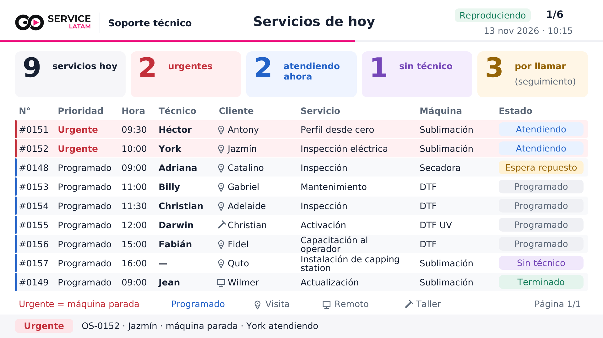
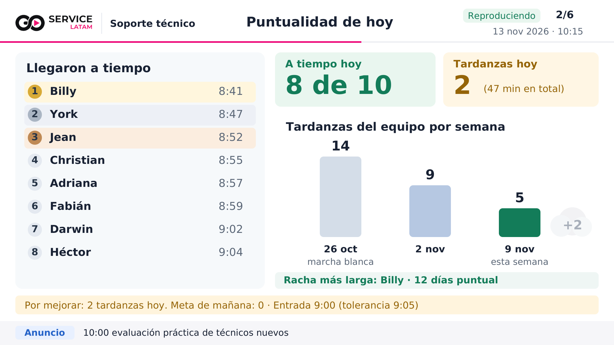
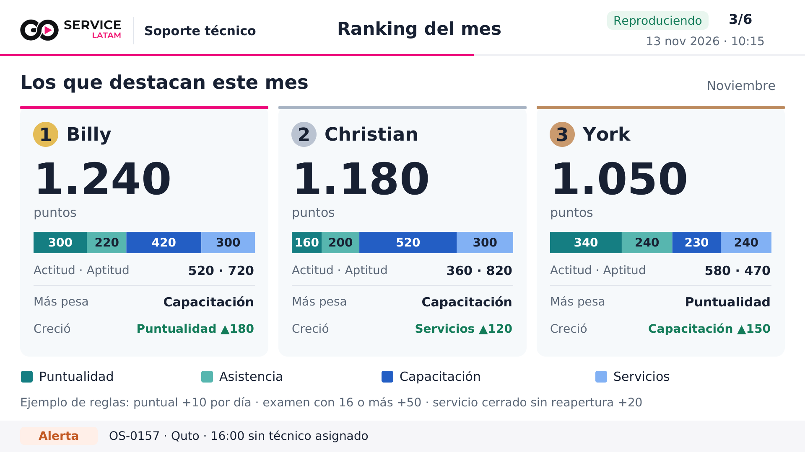
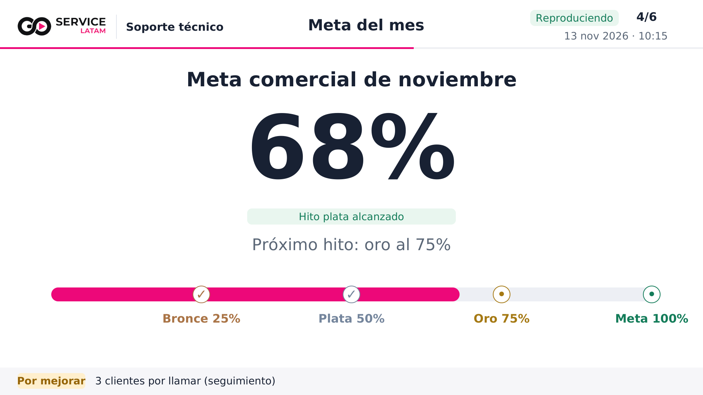
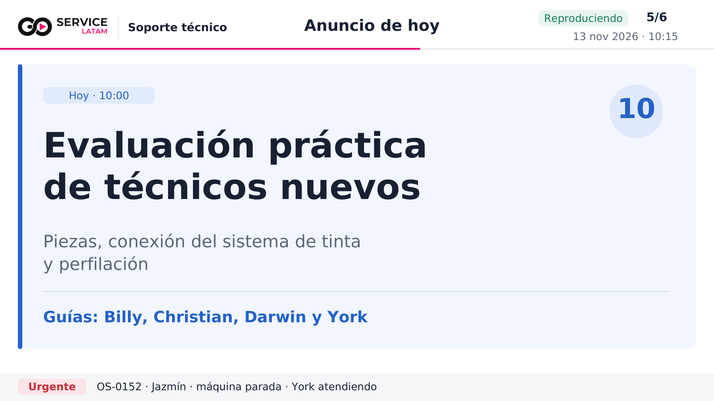
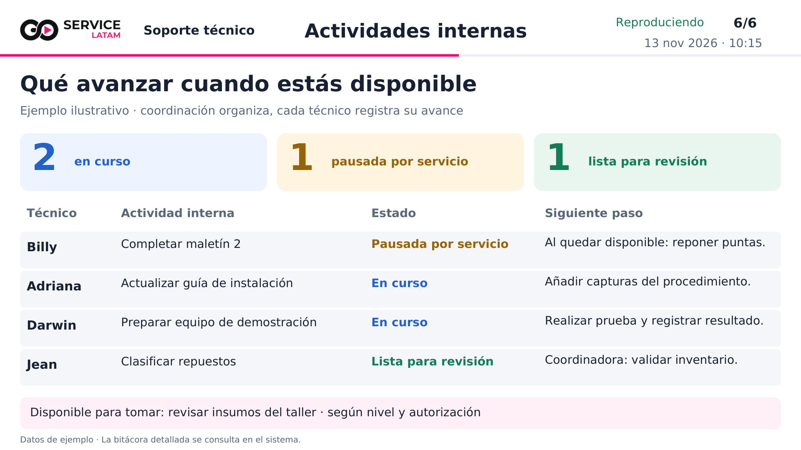
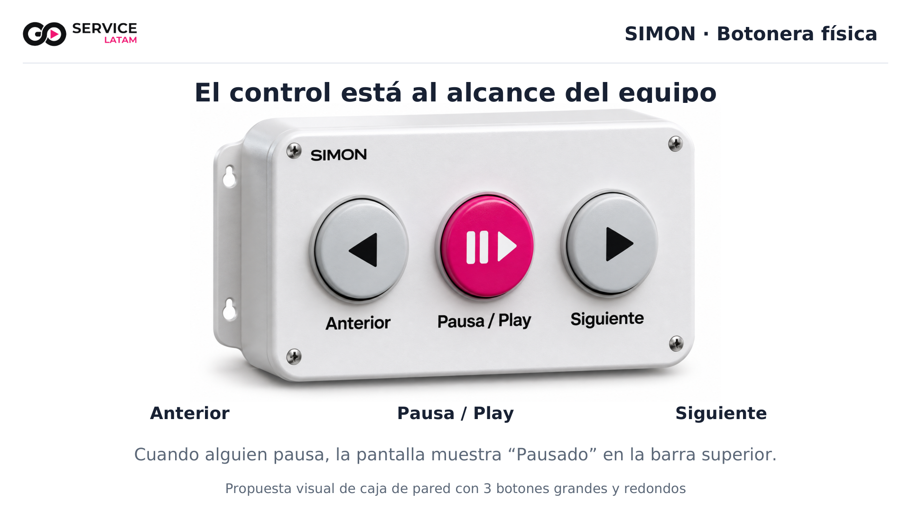

# Propuesta integral de pantallas y operación

> **SIMON**
> **Soporte técnico, actividades internas y avance del equipo**

**Un sistema para saber qué atender, qué avanzar cuando hay disponibilidad y cómo estamos mejorando.**

6 pantallas \+ botonera física \+ proceso de trabajo

Qué reúne esta propuesta

Operación

Servicios de hoy: cliente, técnico, hora, trabajo, máquina, prioridad y estado.

Equipo y empresa

Puntualidad, ranking, meta comercial y anuncios. Sin montos ni nombres de quienes llegaron tarde.

Trabajo interno

Actividades concretas para aprovechar la disponibilidad, con responsable, siguiente paso e historial.

La sexta pantalla se redefine como “Actividades internas”. La bitácora es el historial dentro de cada actividad. Los servicios mantienen su pantalla y su propio registro.

Formato: TV de 42 pulgadas, 16:9, 1920 × 1080\. Mockups blancos para presentar e imprimir. Textos de referencia de al menos 28 px y números principales de 80 px en TV; validar la lectura real a 3-4 metros.

# Servicios de hoy

Mockup de referencia. Datos de ejemplo; diseño blanco para presentación.

# Puntualidad de hoy

Mockup de referencia. Datos de ejemplo; diseño blanco para presentación.

# Ranking del mes

Mockup de referencia. Datos de ejemplo; diseño blanco para presentación.

# Meta del mes

Mockup de referencia. Datos de ejemplo; diseño blanco para presentación.

# Anuncio de hoy

Mockup de referencia. Datos de ejemplo; diseño blanco para presentación.

# Actividades internas

# Botonera física

Mockup de referencia. Datos de ejemplo; diseño blanco para presentación.

Tres funciones, sin duplicar trabajo

Servicios de hoy: Organiza las atenciones a clientes. La orden de servicio conserva cliente, equipo, diagnóstico, solución y compromisos.

Actividades internas: Organiza trabajo del taller, documentación, preparación, aprendizaje y mejora. Indica qué hacer ahora y qué sigue.

Bitácora de actividad: Registra cronológicamente quién avanzó, cuándo, qué hizo, por qué se pausó y qué falta. Permite retomar o entregar el trabajo.

La TV muestra el estado actual y el siguiente paso. El detalle y la evidencia se consultan en el sistema. Una salida a servicio solo aparece como “Pausada por servicio”, sin repetir la orden completa.

En esta propuesta, ninguna pantalla se llama Bitácora: la sexta se llama Actividades internas. La bitácora es el historial que se consulta al abrir cada actividad. El tablero organiza las actividades internas y la bitácora registra su ejecución.

# Proceso diario: asignar, interrumpir y retomar

1\. Preparar: Jefatura define prioridad, resultado esperado y quién valida. La coordinadora asigna según capacidad y disponibilidad.

2\. Iniciar: El técnico consulta su actividad, marca “En curso” y comienza. Debe tener una siguiente actividad preparada.

3\. Atender un servicio: La coordinadora prioriza la atención. Si corresponde interrumpir, la actividad queda “Pausada por servicio” y se guarda el último avance.

4\. Retomar: Al confirmar que el técnico está disponible, el sistema propone retomar. Cerrar una orden no implica que haya regresado o terminado su reporte.

5\. Entregar y validar: El técnico marca “Lista para revisión”. El responsable valida, devuelve con observaciones o da por terminada la actividad.

# Quién organiza y quién actualiza

Héctor y Wilber: Definen prioridades, actividades importantes, nivel requerido y criterio de finalización. Reservan tiempo para capacitación y mejora.

Coordinadora de servicios: Administra la carga diaria: asigna, reorganiza por urgencias, confirma disponibilidad y evita cruces con visitas o prácticas reservadas.

Cada técnico: Inicia, registra avances breves, informa bloqueos, deja un punto de retoma y entrega el resultado con la evidencia necesaria.

Responsable de revisión: Valida lo entregado. Puede ser Héctor, la coordinadora u otra persona definida según el tipo de actividad.

Propuesta de roles por confirmar. La coordinadora organiza, pero no escribe todos los avances por el equipo.

# Ejemplo: una actividad que continúa tras una visita

09:10 · En curso Billy inicia “Revisar y completar el maletín 2”. Resultado esperado: inventario completo y faltantes repuestos o reportados.

10:20 · Pausada Surge un servicio. Registra: “Inventario terminado; faltan dos puntas”. La tarea sigue asignada a Billy.

12:30 · Disponible Termina la atención, regresa y completa su reporte. Confirma disponibilidad. El tablero le indica retomar el maletín.

13:00 · Para revisión Repone las puntas, adjunta lista y marca “Lista para revisión”. La coordinadora verifica y la da por terminada.

Son horarios y actividades de ejemplo. El tiempo pausado por un servicio se registra aparte del tiempo dedicado a la actividad interna.

# Actividades claras y estados fáciles de entender

Revisar herramientas: Termina con una lista completa y faltantes identificados.

Preparar demostración: Termina con prueba realizada, resultado registrado y equipo listo.

Actualizar una guía: Termina con documento revisado y disponible para el equipo.

Practicar perfilación: Termina con práctica registrada y revisión del instructor.

Estados propuestos: Pendiente → En curso → Lista para revisión → Terminada. Estados adicionales: Pausada por servicio y Bloqueada, siempre con motivo y siguiente paso.

Cada técnico: una actividad actual y una siguiente. La lista común solo ofrece tareas habilitadas para su nivel. Las prácticas supervisadas tienen un horario reservado.

# Cómo se conectan el sistema y las pantallas

Fuentes de información

Órdenes de servicio, asistencia y capacitación aportan datos automáticamente. Las actividades internas necesitan registro de avances por el técnico.

Administrador web

La coordinadora gestiona tareas. Usuarios autorizados publican anuncios, metas y configuran pantallas, tiempos, pausa y rotación.

Registro de una actividad: Título, responsable, prioridad, fecha objetivo, criterio de cierre, posibilidad de interrumpir y persona que revisa.

Entrada de bitácora: Hora, autor, avance, estado, motivo de pausa o bloqueo, siguiente paso y evidencia si corresponde.

Propuesta de sincronización: relacionar la pausa con la orden de servicio y conservar historial. Evitar doble asignación activa. No reanudar ni cerrar una actividad sin confirmar su estado.

# Reglas de presentación y decisiones pendientes

Rotación y control: 6 pantallas, igual duración inicial de unos 10 segundos, configurable. Botonera: anterior, pausa/play y siguiente. Mostrar estado, fecha, hora y progreso.

Colores consistentes: Rojo: urgente. Coral: alerta. Azul: programado/anuncio. Ámbar: espera o mejora. Verde: terminado/logro. Morado: sin técnico. Gris: neutro. Siempre añadir texto.

Información compartida: Sin montos en soles, sin nombres de tardanzas ni último lugar. Ranking: top 3\. Marquesina: mensajes importantes del día, sin duplicar métricas.

Antes de implementar: Confirmar reglas de puntos, horario/tolerancia, revisión de tareas, permisos, tareas interrumpibles y disponibilidad real. Validar legibilidad y tiempo de lectura en TV.

Los mockups son ejemplos, no resultados reales ni una política aprobada. El fondo blanco responde a la presentación e impresión solicitadas.

# Implementación inicial y revisión del funcionamiento

1\. Preparar el trabajo: Crear una lista corta de actividades útiles. Cada una necesita responsable, entrega verificable y persona que revisa.

2\. Probar con el equipo: Usar las pantallas y el flujo de pausa/retoma. Observar si cada técnico sabe qué hacer al quedar disponible.

3\. Revisar semanalmente: Mirar tareas entregadas y validadas, bloqueos pendientes, pausas por servicios y personas disponibles sin actividad asignada.

4\. Ajustar e integrar: Afinar duración de vistas, prioridades y permisos. Integrar fuentes y mostrar última sincronización o aviso de datos desactualizados.

Objetivo de la pantalla interna: que el trabajo continúe con claridad, incluso cuando cambian los servicios. La bitácora permite recuperar el contexto sin duplicar la atención al cliente.